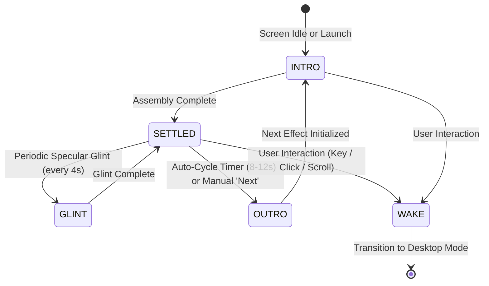

# Personal Website Brainstorming & Architecture
**Project:** Michael Svendsen's Personal Website  
**Repository:** `thesven/personal_webite`  
**Aesthetic & UX Foundation:** Opinionated Linux / Wayland / Hyprland & Terminal Text Desktop Aesthetics  
**Branding Directive:** Strictly independent personal branding (**SVENDSEN** / **thesven** / **michael-svendsen.dev**). No third-party OS brand names appear in the public UI or design. We purely channel the beloved visual craft: Delta Corps Priest 1 block typography, Terminal Text Effects (TTE) procedural animations, Waybar status header, and minimalist dark elegance.

---

## 1. Executive Summary & Vision

The goal is to design and develop a distinguished, high-craft personal website and professional publication platform for **Michael Svendsen**. 

The site bridges two worlds:
1. **The Terminal & Tiling-Desktop Aesthetic**: Minimalist, hyper-focused, keyboard-first, terminal/TUI elegance, dark-mode mastery, crisp borders, subtle glassmorphism, and status bar ("Waybar") styling.
2. **Professional Rigor**: Clean editorial typography, responsive design, fast performance (100/100 Lighthouse), and seamless reading experience for technical essays, research, and project showcases.

---

## 2. The Hero Feature: Authentic Terminal Screensaver Landing

The highlight of the landing experience is a faithful recreation of the iconic terminal screensaver featuring the name **"Michael Svendsen"**.

### Typography & Asset Blueprint
- **Font**: **Delta Corps Priest 1** (the exact FIGlet block font used for iconic terminal block wordmarks).
- **Ascii Art Rendering**:
```text
   ▄▄▄▄███▄▄▄▄    ▄█   ▄████████    ▄█    █▄       ▄████████    ▄████████  ▄█
 ▄██▀▀▀███▀▀▀██▄ ███  ███    ███   ███    ███     ███    ███   ███    ███ ███
 ███   ███   ███ ███▌ ███    █▀    ███    ███     ███    ███   ███    █▀  ███
 ███   ███   ███ ███▌ ███         ▄███▄▄▄▄███▄▄   ███    ███  ▄███▄▄▄     ███
 ███   ███   ███ ███▌ ███        ▀▀███▀▀▀▀███▀  ▀███████████ ▀▀███▀▀▀     ███
 ███   ███   ███ ███  ███    █▄    ███    ███     ███    ███   ███    █▄  ███
 ███   ███   ███ ███  ███    ███   ███    ███     ███    ███   ███    ███ ███▌    ▄
  ▀█   ███   █▀  █▀   ████████▀    ███    █▀      ███    █▀    ██████████ █████▄▄██
                                                                          ▀
   ▄████████  ▄█    █▄     ▄████████ ███▄▄▄▄   ████████▄     ▄████████    ▄████████ ███▄▄▄▄
  ███    ███ ███    ███   ███    ███ ███▀▀▀██▄ ███   ▀███   ███    ███   ███    ███ ███▀▀▀██▄
  ███    █▀  ███    ███   ███    █▀  ███   ███ ███    ███   ███    █▀    ███    █▀  ███   ███
  ███        ███    ███  ▄███▄▄▄     ███   ███ ███    ███   ███         ▄███▄▄▄     ███   ███
▀███████████ ███    ███ ▀▀███▀▀▀     ███   ███ ███    ███ ▀███████████ ▀▀███▀▀▀     ███   ███
         ███ ███    ███   ███    █▄  ███   ███ ███    ███          ███   ███    █▄  ███   ███
   ▄█    ███ ███    ███   ███    ███ ███   ███ ███   ▄███    ▄█    ███   ███    ███ ███   ███
 ▄████████▀   ▀██████▀    ██████████  ▀█   █▀  ████████▀   ▄████████▀    ██████████  ▀█   █▀
```

### Motion & Visual Effects (TTE / Procedural Parity)
The screensaver runs Terminal Text Effects (`tte`) across a rich palette of procedural animations. Our canvas renderer models the full four-phase graphics lifecycle:

#### 1. The 4-Phase Graphics State Machine


1. **State: INTRO (Assembly / Genesis)**:
   - Starts from black/empty canvas. Characters are drawn through active physical or digital procedural effects.
   - Particle generation, column drops, beam sweeps, and entropy reduction.
2. **State: SETTLED (Luminous Steady-State)**:
   - Full Delta Corps Priest 1 block letters locked into their geometric positions.
   - Dynamic multi-layer radial phosphor bloom radiating into the dark background.
   - Subtle breathing pulse (1-2% luminance oscillation mimicking cathode-ray / OLED illumination).
3. **State: GLINT (Idle Specular Polish)**:
   - Subtle procedural shine: a delicate diagonal phosphor glint leans across the letters every 4–6 seconds, keeping the art alive without distraction.
4. **State: OUTRO (Decay & Hand-Off)**:
   - Digital crumble, laser wipe-off, or matrix cascade down, resetting the canvas cleanly before transitioning to the next random effect.
5. **State: WAKE (Interactive Desktop Morph)**:
   - On keypress (`Space`, `Enter`, arrows) or click/scroll, the screensaver gracefully dissolves or scales into the site's top Waybar hero, activating the desktop workspace.

#### 2. The Complete Terminal Effect Suite (8 Graphic States)
1. **`decrypt` (Cryptographic Entropy Resolution)**:
   - Multi-stage deciphering sweep. Scrambled hex tokens (`0x7F`, `!@#$%`, `1010`) flicker rapidly before column-by-column settling into block glyphs with an emerald/cyan flash.
2. **`matrix` (Digital Code Cascade)**:
   - Rain streams falling down independent vertical columns with varying velocities.
   - Incandescent white droplet heads, vibrant green phosphorescent trails, and permanent sedimentation into the name glyphs.
3. **`beams` / `laseretch` (Precision Laser Scan)**:
   - High-energy traveling laser line with spark particle emitters trailing behind.
   - Laser head etches the block characters onto the dark substrate.
4. **`burn` / `ember` (Thermodynamic Convection)**:
   - Volumetric fire and thermal gradient simulation.
   - Particles ignite at the base, rising through dark crimson, bright orange, and incandescent gold-white, before cooling into the resting theme color.
5. **`waves` / `colorshift` (Harmonic Phase Ripple)**:
   - Multi-frequency sinusoidal displacement waves undulating horizontally across the letter matrix.
   - Dynamic chromatic shift cycling through the palette stops.
6. **`spotlights` (Nocturnal Dual Searchlights)**:
   - Two sweeping radial light cones oscillating across pitch black, only illuminating characters and generating shadows where the light fields intersect.
7. **`vhstape` / `glitch` (Analog Cathode Breakdown)**:
   - Horizontal slice displacement, tracking line roll, chromatic aberration (RGB color channel splitting), and analog noise grain.
8. **`binarypath` (PCB Logic Traces)**:
   - Discrete glowing `0` and `1` digital pulses coursing along rectilinear circuit paths, converging into each letter node.

#### 3. Environmental Atmosphere & Sound Design
- **CRT Aesthetics**: Optional curved screen vignette, subtle horizontal scanline grid, and adjustable bloom.
- **Synthesized Haptics & Audio**: Built-in Web Audio API mechanical switch clicks (`clicky` / `tactile` / `soft`) responding to keypresses and wake actions.

---

## 3. UI/UX Structure (Modern Tiling-Desktop Metaphor)

The site's signature look is derived from modern Arch Linux + Hyprland + Waybar + minimal terminal workflows:

### 3.1 The Top Bar ("Waybar" Header)
- **Workspaces Indicator (Navigation)**:
  - `[1: Home]` — Screensaver Hero + Quick Intro & Featured Work
  - `[2: Articles]` — Technical writing, essays, and notes
  - `[3: Projects]` — Portfolio, open-source work, system architecture
  - `[4: About / CV]` — Professional journey, background, credentials
  - `[5: Contact]` — Direct email, GitHub, LinkedIn, PGP key
- **Brand Moniker**: `SVENDSEN` with active status pulse chip.
- **Center Pill**: Current active article title or breadcrumb path.
- **Right Status Tray**:
  - `[Toggles]`: Screensaver activator (`Super+Esc`), Theme picker, Sound/Ambient effects.
  - `[Clock]`: Clean system clock with local time zone.
  - `[Command Palette Trigger]`: `⌘K` / `Ctrl+K`.

### 3.2 Themes & Palette Inspiration
Curated color palettes available via one-click theme switcher:
- **Tokyo Night** (Classic dark blue-indigo with cyan/magenta highlights)
- **Flexoki Dark** (Warm inky paper tone, easy on eyes)
- **Oxocarbon** (High-contrast obsidian, crisp gray, stark white, neon teal)
- **Catppuccin Mocha** (Muted slate with soft lavender and sky blue)
- **Monochrome Matrix** (True black, phosphor green, white highlights)

### 3.3 Editorial & Typography
- **Monospace Accents**: JetBrains Mono or Berkeley Mono for headers, navigation, dates, tags, and code blocks.
- **Body Content**: Inter, Geist, or Newsreader/Source Serif for long-form reading comfort.
- **Cards & Panes**: Floating window aesthetic with 1px translucent borders (`border-white/10`), subtle drop shadows, and subtle background blur (`backdrop-blur-md`).

---

---

## 4. Interior Pages Architecture & UX Polish

The site structure adopts a **tiling desktop workspace model**, where switching workspaces via keyboard shortcuts (`1`, `2`, `3`, `4`) or Waybar tabs feels instantaneous, persistent, and fluid:

### 4.1 Workspace 1: Dashboard (`1:hero`)
- **Tiling Hero Window**: Window titlebar with macOS/Hyprland window controls (`● ● ●`), system telemetry chip (`arch: x86_64`, `wm: hyprland`, `status: active`), and executive positioning statement.
- **Split Layout**:
  - Left column: Latest featured dispatch snippets with direct jump to article reader.
  - Right column: Host information TUI box (kernel, compositor, primary stack, GitHub profile) and flagship build highlight.

### 4.2 Workspace 2: Articles Hub & Publications (`2:articles`)
- **Interactive Tag Filtering**: Instant category switching (`All`, `#systems`, `#architecture`, `#performance`, `#tooling`) without full-page reloads.
- **Publication Card Meta**:
  - Semantic tag pill, publication timestamp, calculated read time, and hover transition indicators.
- **In-Depth Article Reader Modal**:
  - Clicking any card opens a distraction-free, high-craft editorial modal.
  - Breadcrumb navigation (`publication://systems-design`).
  - GitHub-style callouts (`> [!NOTE]`, `> [!TIP]`).
  - Tabbed syntax-highlighted code blocks with language indicators and one-click copy buttons.
  - Keyboard accessible: dismissible instantly via `Esc`.

### 4.3 Workspace 3: Work & Projects Showcase (`3:work`)
- **Flagship Project Feature**:
  - Deep-dive card for flagship repositories (`sys-toolkit`).
  - Embedded ASCII architecture schema visualizing data flow from kernel/eBPF through event ring buffers to Wayland IPC and TUI renderers.
  - Metadata badges: Language toolchain (Rust, Go), license, release state, and live links.
- **Secondary Grid**:
  - Modular cards for supporting projects, lab infrastructure (`infra-core`), and web tools.

### 4.4 Workspace 4: Biography & Career Journal (`4:about`)
- **Executive Bio**: Engineering values, distributed systems focus, and opinionated software craftsmanship philosophy.
- **System Journal / Work History**:
  - Minimalist timeline styled like a system journal (`SYSTEM_JOURNAL // WORK_HISTORY`).
  - Chronological positions (Principal Architect, Staff Infrastructure Lead, Senior Systems Engineer) with measurable impact metrics.
- **Core Architectural Competency Matrix**:
  - Visual competency meters displaying mastery in distributed systems, cloud infrastructure, systems programming, and performance graphics.
- **Direct Contact & Security Keycard**:
  - PGP fingerprint block (`4A92 F81C 023E B7D8`) with copy capability, verified GitHub link, remote location status, and advisory availability.

### 4.5 The Command Palette (`⌘K` / `Ctrl+K`)
- Walker-inspired floating launcher modal accessible from any screen via `⌘K` or the top Waybar search pill.
- Supports instant fuzzy filtering to:
  - Jump directly between workspaces (`1` to `4`).
  - Trigger screensaver mode (`Space`).
  - Change color themes on the fly (`Tokyo Night`, `Flexoki`, `Oxocarbon`, `Catppuccin`, `Monochrome`).
  - Dismissible via `Esc` or clicking outside.

---

## 5. Technology Stack Recommendation

| Dimension | Recommended Option: **Astro + Tailwind CSS** | Alternative: **Next.js (App Router)** |
| :--- | :--- | :--- |
| **Why it fits** | Ultra-lightweight, zero client-side JS overhead on blog posts, native Markdown/MDX content collections, fastest loading speeds. | Great if server-side database authentication or dynamic real-time features are required. |
| **Animation Engine** | HTML5 Canvas / Lightweight Vanilla JS for screensaver effects (60-120fps with minimal CPU). | Framer Motion + Canvas. |
| **Styling** | Tailwind CSS v4 with custom theme tokens matching Omarchy palettes. | Tailwind CSS. |
| **Hosting** | Free, instant deployment on **GitHub Pages** (directly from this repo) or Cloudflare Pages / Vercel. | Vercel / Cloudflare. |

---

## 6. Next Steps & Discussion Points

1. **Profession / Specialization**: Confirm Michael's core domains to tailor copy, categories, and showcase layout.
2. **Screensaver Behavior**: Decide whether the screensaver is a fullscreen intro that fades on scroll/keypress, an interactive hero section at the top of the home page, or a toggleable mode.
3. **Interactive Prototype**: Review the live interactive screensaver prototype built in the artifact directory.
