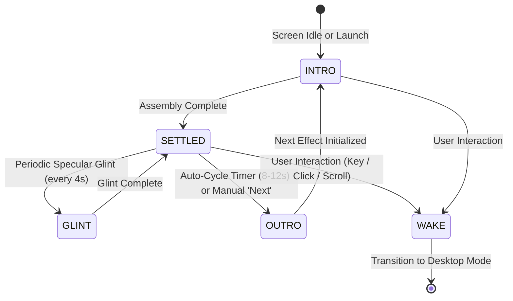

# Personal Website Brainstorming & Architecture
**Project:** Michael Svendsen's Personal Website  
**Repository:** `thesven/personal_webite`  
**Aesthetic & UX Foundation:** Inspired by the **Omarchy OS** UI & Default Screensaver  

---

## 1. Executive Summary & Vision

The goal is to design and develop a distinguished, high-craft personal website and professional publication platform for **Michael Svendsen**. 

The site bridges two worlds:
1. **The Omarchy Aesthetic**: Minimalist, hyper-focused, keyboard-first, terminal/TUI elegance, dark-mode mastery, crisp borders, subtle glassmorphism, and status bar ("Waybar") styling.
2. **Professional Rigor**: Clean editorial typography, responsive design, fast performance (100/100 Lighthouse), and seamless reading experience for technical essays, research, and project showcases.

---

## 2. The Hero Feature: Authentic Omarchy Screensaver Landing

The highlight of the landing experience is a faithful recreation of the **Omarchy default screensaver** featuring the name **"Michael Svendsen"**.

### Typography & Asset Blueprint
- **Font**: **Delta Corps Priest 1** (the exact FIGlet block font used by Omarchy's wordmark and `omarchy-ascii` tool).
- **Ascii Art Rendering**:
```text
   ▄▄▄▄███▄▄▄▄    ▄█   ▄████████    ▄█    █▄       ▄████████    ▄████████  ▄█
 ▄██▀▀▀███▀▀▀██▄ ███  ███    ███   ███    ███     ███    ███   ███    ███ ███
 ███   ███   ███ ███▌ ███    █▀    ███    ███     ███    ███   ███    █▀  ███
 ███   ███   ███ ███▌ ███         ▄███▄▄▄▄███▄▄   ███    ███  ▄███▄▄▄     ███
 ███   ███   ███ ███▌ ███        ▀▀███▀▀▀▀███▀  ▀███████████ ▀▀███▀▀▀     ███
 ███   ███   ███ ███  ███    █▄    ███    ███     ███    ███   ███    █▄  ███
 ███   ███   ███ ███  ███    ███   ███    ███     ███    ███   ███    ███ ███▌    ▄
  ▀█   ███   █▀  █▀   ████████▀    ███    █▀      ███    █▀    ██████████ █████▄▄██
                                                                          ▀
   ▄████████  ▄█    █▄     ▄████████ ███▄▄▄▄   ████████▄     ▄████████    ▄████████ ███▄▄▄▄
  ███    ███ ███    ███   ███    ███ ███▀▀▀██▄ ███   ▀███   ███    ███   ███    ███ ███▀▀▀██▄
  ███    █▀  ███    ███   ███    █▀  ███   ███ ███    ███   ███    █▀    ███    █▀  ███   ███
  ███        ███    ███  ▄███▄▄▄     ███   ███ ███    ███   ███         ▄███▄▄▄     ███   ███
▀███████████ ███    ███ ▀▀███▀▀▀     ███   ███ ███    ███ ▀███████████ ▀▀███▀▀▀     ███   ███
         ███ ███    ███   ███    █▄  ███   ███ ███    ███          ███   ███    █▄  ███   ███
   ▄█    ███ ███    ███   ███    ███ ███   ███ ███   ▄███    ▄█    ███   ███    ███ ███   ███
 ▄████████▀   ▀██████▀    ██████████  ▀█   █▀  ████████▀   ▄████████▀    ██████████  ▀█   █▀
```

### Motion & Visual Effects (TTE / ttfx Parity)
The real Omarchy screensaver runs Terminal Text Effects (`tte` / `ttfx`) across a rich palette of terminal animations. To achieve 100% parity on the web, our canvas renderer models the full four-phase graphics lifecycle:

#### 1. The 4-Phase Graphics State Machine


1. **State: INTRO (Assembly / Genesis)**:
   - Starts from black/empty canvas. Characters are drawn through active physical or digital procedural effects.
   - Particle generation, column drops, beam sweeps, and entropy reduction.
2. **State: SETTLED (Luminous Steady-State)**:
   - Full Delta Corps Priest 1 block letters locked into their geometric positions.
   - Dynamic multi-layer radial phosphor bloom radiating into the dark background.
   - Subtle breathing pulse (1-2% luminance oscillation mimicking cathode-ray / OLED illumination).
3. **State: GLINT (Idle Specular Polish)**:
   - Faithful to Omarchy's signature About/Screensaver window behavior: a delicate diagonal phosphor glint leans across the letters every 4–6 seconds, keeping the art alive without distraction.
4. **State: OUTRO (Decay & Hand-Off)**:
   - Digital crumble, laser wipe-off, or matrix cascade down, resetting the canvas cleanly before transitioning to the next random effect.
5. **State: WAKE (Interactive Desktop Morph)**:
   - On keypress (`Space`, `Enter`, arrows) or click/scroll, the screensaver gracefully dissolves or scales into the site's top Waybar hero, activating the desktop workspace.

#### 2. The Complete Omarchy Effect Suite (8 Graphic States)
1. **`decrypt` (Cryptographic Entropy Resolution)**:
   - Multi-stage deciphering sweep. Scrambled hex tokens (`0x7F`, `!@#$%`, `1010`) flicker rapidly before column-by-column settling into block glyphs with an emerald/cyan flash.
2. **`matrix` (Digital Code Cascade)**:
   - Rain streams falling down independent vertical columns with varying velocities.
   - Incandescent white droplet heads, vibrant green phosphorescent trails, and permanent sedimentation into the name glyphs.
3. **`beams` / `laseretch` (Precision Laser Scan)**:
   - High-energy traveling laser line with spark particle emitters trailing behind.
   - Laser head etches the block characters onto the dark substrate.
4. **`burn` / `ember` (Thermodynamic Convection)**:
   - Volumetric fire and thermal gradient simulation.
   - Particles ignite at the base, rising through dark crimson, bright orange, and incandescent gold-white, before cooling into the resting theme color.
5. **`waves` / `colorshift` (Harmonic Phase Ripple)**:
   - Multi-frequency sinusoidal displacement waves undulating horizontally across the letter matrix.
   - Dynamic chromatic shift cycling through the palette stops.
6. **`spotlights` (Nocturnal Dual Searchlights)**:
   - Two sweeping radial light cones oscillating across pitch black, only illuminating characters and generating shadows where the light fields intersect.
7. **`vhstape` / `glitch` (Analog Cathode Breakdown)**:
   - Horizontal slice displacement, tracking line roll, chromatic aberration (RGB color channel splitting), and analog noise grain.
8. **`binarypath` (PCB Logic Traces)**:
   - Discrete glowing `0` and `1` digital pulses coursing along rectilinear circuit paths, converging into each letter node.

#### 3. Environmental Atmosphere & Sound Design
- **CRT Aesthetics**: Optional curved screen vignette, subtle horizontal scanline grid, and adjustable bloom.
- **Synthesized Haptics & Audio**: Built-in Web Audio API mechanical switch clicks (`clicky` / `tactile` / `soft`) responding to keypresses and wake actions.

---

## 3. UI/UX Structure (Omarchy Desktop Metaphor)

Omarchy's signature look is derived from Arch Linux + Hyprland + Waybar + Quickshell:

### 3.1 The Top Bar ("Waybar" Header)
- **Workspaces Indicator (Navigation)**:
  - `[1: Home]` — Screensaver Hero + Quick Intro & Featured Work
  - `[2: Articles]` — Technical writing, essays, and notes
  - `[3: Projects]` — Portfolio, open-source work, system architecture
  - `[4: About / CV]` — Professional journey, background, credentials
  - `[5: Contact]` — Direct email, GitHub, LinkedIn, PGP key
- **Center Pill**: Current active article title or breadcrumb path.
- **Right Status Tray**:
  - `[Toggles]`: Screensaver activator (`Super+Esc`), Theme picker, Sound/Ambient effects (optional retro key clicks).
  - `[Clock]`: Clean system clock with local time zone.
  - `[Command Palette Trigger]`: `⌘K` / `Ctrl+K` (mimicking Omarchy's Walker / menu launcher).

### 3.2 Themes & Palette Inspiration
Omarchy is famous for curated color palettes. We can provide a one-click theme switcher:
- **Tokyo Night** (Classic dark blue-indigo with cyan/magenta highlights)
- **Flexoki Dark** (Warm inky paper tone, easy on eyes, DHH favorite)
- **Oxocarbon** (High-contrast obsidian, crisp gray, stark white, neon teal)
- **Batavia / Gruvbox / Catppuccin Mocha**

### 3.3 Editorial & Typography
- **Monospace Accents**: JetBrains Mono or Berkeley Mono for headers, navigation, dates, tags, and code blocks.
- **Body Content**: Inter, Geist, or Newsreader/Source Serif for long-form reading comfort.
- **Cards & Panes**: Floating window aesthetic with 1px translucent borders (`border-white/10`), subtle drop shadows, and subtle background blur (`backdrop-blur-md`).

---

## 4. Content Architecture & Publishing Workflow

### 4.1 Articles & Notes
- Categorized by topic (e.g. Systems Architecture, Software Engineering, AI & Automation, Infrastructure, Leadership).
- Markdown / MDX workflow: Articles stored as `.md` or `.mdx` files with frontmatter (title, date, tags, description, draft status).
- Features:
  - Estimated reading time
  - Interactive table of contents
  - Code blocks with syntax highlighting, copy button, and file-tab headers
  - RSS / Atom feed generation (`/rss.xml`) for technical readers

### 4.2 Project & Open-Source Showcase
- Card layout displaying active repositories, live demos, architecture diagrams, and tech tags.
- Direct integration with GitHub API (optional dynamic star/commit counts).

### 4.3 Search & Command Palette (`Super + Space` / `⌘K`)
- In-browser instant search across all articles, tags, and pages using a fuzzy search engine (Pagefind or Fuse.js).

---

## 5. Technology Stack Recommendation

| Dimension | Recommended Option: **Astro + Tailwind CSS** | Alternative: **Next.js (App Router)** |
| :--- | :--- | :--- |
| **Why it fits** | Ultra-lightweight, zero client-side JS overhead on blog posts, native Markdown/MDX content collections, fastest loading speeds. | Great if server-side database authentication or dynamic real-time features are required. |
| **Animation Engine** | HTML5 Canvas / Lightweight Vanilla JS for screensaver effects (60-120fps with minimal CPU). | Framer Motion + Canvas. |
| **Styling** | Tailwind CSS v4 with custom theme tokens matching Omarchy palettes. | Tailwind CSS. |
| **Hosting** | Free, instant deployment on **GitHub Pages** (directly from this repo) or Cloudflare Pages / Vercel. | Vercel / Cloudflare. |

---

## 6. Next Steps & Discussion Points

1. **Profession / Specialization**: Confirm Michael's core domains to tailor copy, categories, and showcase layout.
2. **Screensaver Behavior**: Decide whether the screensaver is a fullscreen intro that fades on scroll/keypress, an interactive hero section at the top of the home page, or a toggleable mode.
3. **Interactive Prototype**: Review the live interactive screensaver prototype built in the artifact directory.
